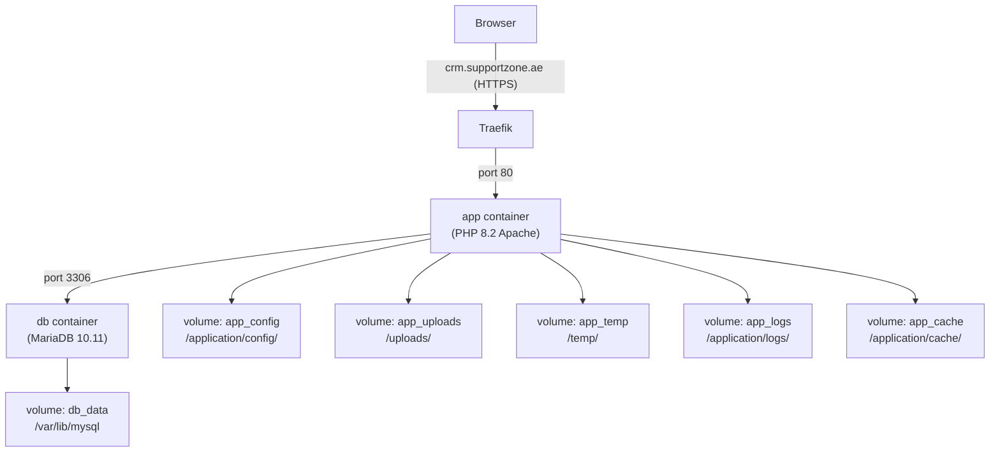

# Dockerize Perfex CRM for Dokploy (`crm.supportzone.ae`)

## Architecture

## Persistent Volumes

The following named volumes are mounted to preserve data across container restarts and redeployments:

| Volume | Container Mount Path | Purpose |
|---|---|---|
| `app_config` | `/var/www/html/application/config` | Stores `app-config.php` and custom configuration |
| `app_uploads` | `/var/www/html/uploads` | Client documents, avatars, contract attachments, etc. |
| `app_temp` | `/var/www/html/temp` | Temporary PDF generations and system exports |
| `app_logs` | `/var/www/html/application/logs` | Application logs and error diagnostics |
| `app_cache` | `/var/www/html/application/cache` | Performance caching files |
| `db_data` | `/var/lib/mysql` | MariaDB / MySQL persistent database storage |

## Key Docker Files

1. **`Dockerfile`**:
   - Uses `php:8.2-apache-bookworm` with all required system libraries.
   - Installs required PHP extensions: `pdo_mysql`, `mysqli`, `gd`, `zip`, `xml`, `mbstring`, `intl`, `imap`, `opcache`, `exif`, `bcmath`.
   - Enables Apache modules: `rewrite`, `headers`, `expires`.
   - Configures `docker/apache/perfex.conf` (AllowOverride All for `.htaccess`, denies direct access to `/application` and `/system`).
   - Configures `docker/php/uploads.ini` (64MB upload limit, 256MB memory, 300s timeout).
   - Initializes `app-config.php` from `app-config-sample.php` if not already present.
   - Applies proper file and directory permissions (`775` on uploads, temp, logs, cache).

2. **`docker-compose.yml`**:
   - App service with persistent named volumes and healthcheck dependency.
   - Database service with healthcheck ping.
   - Dokploy Traefik routing configuration for `crm.supportzone.ae`.
   - Overlay networking support.

3. **`.env` and `.env.example`**:
   - Centralized database credentials and application base URL.
